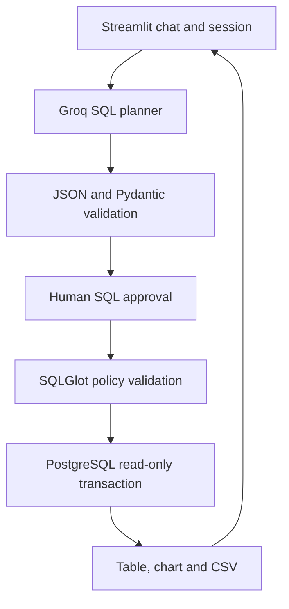

# Chat with SQL Database — AI Data Analyst

Intermediate GenAI portfolio project using **Groq API, PostgreSQL and Streamlit**.
Ask retail questions in English, inspect proposed SQL, approve execution, and explore
tabular results, simple charts and CSV exports. No OpenAI key or LangChain required.

## Features
- Conversational context: last three questions; up to 20 turns per browser session.
- Groq JSON-mode query planning with Pydantic response validation.
- Fail-closed SQL AST validation plus PostgreSQL read-only execution.
- Human approval, 5-second database timeout, 200-row display limit.
- Synthetic embedded dataset: 6 products and 1,080 sales across 180 days.
- Password-gated demo, CSV export and automatic numeric bar charts.
- Unit tests, mocked provider test, PostgreSQL integration tests and GitHub Actions.

## Architecture

Groq receives questions, recent questions, and the fixed schema description. It never
receives database credentials or result rows. The answer is grounded by displaying
actual query results; the model explains its proposed query before execution. There
is deliberately no second model call that could invent a result narrative.

## Folder structure
```text
sql-ai-analyst/
├── app.py
├── analyst/
│   ├── __init__.py
│   ├── config.py
│   ├── schema.py
│   ├── llm.py
│   ├── guard.py
│   └── db.py
├── sql/
│   ├── 001_demo.sql
│   └── 002_reader.sql
├── tests/
│   ├── test_app.py
│   ├── test_guard.py
│   ├── test_llm.py
│   └── test_integration.py
├── docs/
│   ├── DEPLOYMENT.md
│   ├── SECURITY.md
│   └── TESTING.md
├── .github/workflows/tests.yml
├── .streamlit/secrets.toml.example
├── .env.example
├── .gitignore
├── docker-compose.yml
├── requirements.txt
├── requirements-dev.txt
├── pyproject.toml
├── LICENSE
└── README.md
```

## Implementation steps: local development
1. Install Python **3.11**, Git, Docker Desktop (or Docker Engine with Compose).
   Create a Groq account at https://console.groq.com and generate an API key.
2. Extract this project, open its folder in VS Code, and open the terminal.
3. Create and activate a virtual environment:
   ```bash
   python -m venv .venv
   source .venv/bin/activate
   ```
   Windows PowerShell: `.venv\Scripts\Activate.ps1`.
4. Install dependencies:
   ```bash
   python -m pip install -r requirements-dev.txt
   ```
5. Copy `.env.example` to `.env`. Set `GROQ_API_KEY` and a long random
   `APP_PASSWORD`. Keep the local `DATABASE_URL` for the provided Docker database.
   Model default is `llama-3.3-70b-versatile`; change `GROQ_MODEL` if your account
   requires a different chat model supporting JSON-object mode.
6. Start PostgreSQL:
   ```bash
   docker compose up -d --wait
   ```
   Initialization creates the schema, dataset and non-owner `analyst` account.
   Initialization scripts run only when the volume is new. Restarting does not
   reseed an existing volume. For a deliberate fresh start use
   `docker compose down -v` (deletes this project's local database).
7. Launch the app:
   ```bash
   streamlit run app.py
   ```
   Open http://localhost:8501 and enter `APP_PASSWORD`.
8. Ask a question, inspect SQL, then click **Run approved query**.
9. Run tests as described in [TESTING.md](docs/TESTING.md).
10. Upload to GitHub and deploy using [DEPLOYMENT.md](docs/DEPLOYMENT.md).

## Example questions
- How many sales records are there? (Expected: 1,080.)
- Which category earned the most revenue in March 2025?
- Compare monthly units sold by region.
- What are the top three products by revenue across all available dates?
- What was the average discount by region?
- Follow-up: Now show only North for the same period.

Revenue is quantity × product unit price × (1 − discount percentage / 100).
Prices are static in this synthetic dataset. A sales row represents a product sale,
not necessarily a distinct customer order. No profit or customer metrics are available.

## Dependencies and design choices
| Dependency | Purpose |
|---|---|
| Streamlit | Chat UI, sessions, tables, charts, secrets |
| httpx | Groq REST call with bounded timeout |
| psycopg binary | PostgreSQL driver without a local compiler |
| SQLGlot | Parse and inspect SQL syntax trees |
| Pydantic | Validate JSON response contract |
| python-dotenv | Load local development secrets |
| pandas | Result tables and CSV |
| pytest / Ruff | Automated tests and linting |

Version ranges are bounded and intentionally readable. For a reproducible personal
release, install in a clean Python 3.11 environment, run CI, then generate and review
an exact dependency lock (`pip freeze > requirements-lock.txt`). Revalidate SQL guard
tests whenever updating SQLGlot. Do not blindly upgrade the parser.

## Adapting to your own database
Create a dedicated analytics schema containing only approved sanitized tables or views.
Update `analyst/schema.py`, the table allowlist, explicit SQL grants and tests together.
Never connect the application as a database owner or administrator. Validate business
metrics against known SQL baselines. This app has schema context, not a vector database
or a training/fine-tuning pipeline; no model training is necessary.

## Limitations
Natural-language SQL can be syntactically valid yet answer the wrong question. Review
joins, date filters and business definitions. The SQL subset intentionally excludes CTEs,
unions, arbitrary functions and writes. Follow-up questions are best effort. The shared
password and session cooldown are demo controls, not enterprise identity or global rate
limiting. Public demos must use synthetic data. Free hosting can sleep and has quotas.

## Sources
Official setup documentation, checked 21 October 2026:
- Groq models: https://console.groq.com/docs/models
- Groq API: https://console.groq.com/docs/api-reference
- Groq JSON outputs: https://console.groq.com/docs/structured-outputs
- Groq limits: https://console.groq.com/docs/rate-limits
- Streamlit deployment: https://docs.streamlit.io/deploy/streamlit-community-cloud/deploy-your-app/deploy
- Streamlit secrets: https://docs.streamlit.io/deploy/streamlit-community-cloud/deploy-your-app/secrets-management
- Neon plans: https://neon.com/pricing
- PostgreSQL settings: https://www.postgresql.org/docs/current/runtime-config-client.html

MIT licensed. This archive is ready to push; it does not create a remote repository,
provision accounts or deploy automatically.
